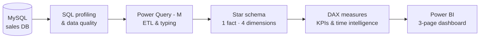
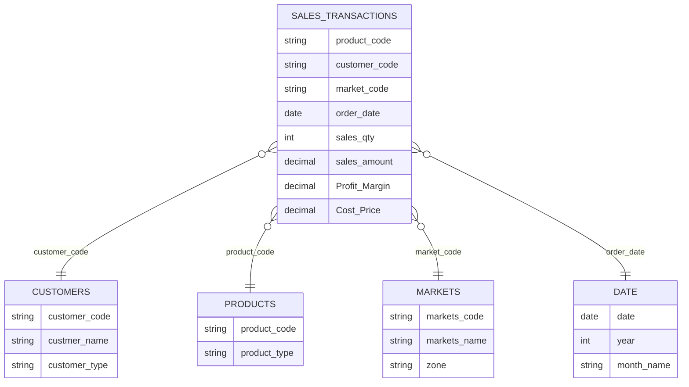

<div align="center">

# 📊 Sales Insights Morocco
### Revenue & Profitability Decision Dashboard — MySQL · Power Query · DAX · Power BI


**From a relational database to executive decisions: where revenue is made, where margin is lost, and what to do about it.**


</div>

---

## 📑 Table of Contents

1. [Executive Summary](#-executive-summary)
2. [Business Context](#-business-context)
3. [Project Framing — AIMS Grid](#-project-framing--aims-grid)
4. [Dataset at a Glance](#-dataset-at-a-glance)
5. [Architecture & Pipeline](#%EF%B8%8F-architecture--pipeline)
6. [Data Model](#-data-model-star-schema)
7. [DAX Measures](#-dax-measures)
8. [Dashboard Walkthrough](#-dashboard-walkthrough)
9. [Key Insights](#-key-insights)
10. [Recommendations](#-recommendations)
11. [Skills Demonstrated](#-skills-demonstrated)
12. [How to Reproduce](#%EF%B8%8F-how-to-reproduce)
13. [Next Steps](#-next-steps)
14. [About Me](#-about-me)

---

## ⚡ Executive Summary

<table>
<tr>
<td align="center"><b>98.5M MAD</b><br/>Total revenue</td>
<td align="center"><b>2.6M MAD</b><br/>Total profit</td>
<td align="center"><b>2.64%</b><br/>Overall margin</td>
<td align="center"><b>2.43M</b><br/>Units sold</td>
<td align="center"><b>148K</b><br/>Transactions</td>
</tr>
</table>

| | |
|---|---|
| 🧩 **Problem** | Declining sales, no reliable view of regional performance, reporting done manually in Excel |
| 🛠️ **Solution** | Automated Power BI dashboard connected live to MySQL — star schema, DAX measures, 3 analytical pages |
| 🔎 **Key finding** | Casablanca brings **53% of revenue at only 2.55% margin**, one customer weighs **42% of sales**, two markets **lose money** |
| 🎯 **Outcome** | 4 concrete recommendations on pricing, key-account risk and margin monitoring |

---

## 📖 Business Context

**Atlas Distribution** is a (fictional) distributor of computer hardware and peripherals, selling through **brick-and-mortar stores** and **e-commerce partners** in **14 Moroccan cities**.

> *"I know sales are going down, but I don't know where, with whom, or why."* — the Sales Director's situation

- Data was scattered across complex Excel files.
- Regional managers struggled to interpret raw numbers.
- Decisions on pricing and discounts were delayed — and taken without margin visibility.

**Objective:** replace manual reporting with an automated, interactive solution that surfaces **sales and profitability insights** and supports data-driven decisions.

---

## 🎯 Project Framing — AIMS Grid

| Dimension | Definition |
|---|---|
| **Purpose** | Unlock hidden sales insights and stop manual data gathering |
| **Stakeholders** | Sales Director · Marketing · Customer Service · Data & Analytics · IT |
| **End Result** | An automated, interactive dashboard with up-to-date sales and margin insights |
| **Success Criteria (targets)** | Faster decisions on loss-making markets · reduced time spent on manual reporting · margin monitored against a target |

---

## 🗂️ Dataset at a Glance

| Table | Role | Rows | Content |
|---|---|---:|---|
| `transactions` | Fact | 148,395 | Product, customer, market, date, quantity, revenue, cost, profit (MAD) |
| `customers` | Dimension | 38 | Customer name, type (Brick & Mortar / E-Commerce) |
| `products` | Dimension | 338 | Product code, type (Own Brand / Distribution / Unclassified) |
| `markets` | Dimension | 15 | City + administrative region (14 cities, 9 regions) |
| `date` | Dimension | 1,126 | Calendar: date, month, year |

📅 **Period:** Oct 2021 – Jun 2024  ·  💱 **Currency:** Moroccan Dirham (MAD)

---

## 🛠️ Architecture & Pipeline



### 1️⃣ Data Discovery & Quality — MySQL
- Restored the `sales` database in **MySQL Workbench** and profiled every table with SQL (**JOINs, aggregations, GROUP BY**).
- Cross-checked KPIs in SQL before building visuals (revenue by city, year, customer).
- 🐞 **Data-quality issue found and fixed:** 59 product codes used in sales were **missing from the product table** — about **47% of revenue** was showing as *"(Blank)"* in visuals. Orphan codes were added as `Unclassified` so every sale is traceable.

<details>
<summary><b>👉 See the SQL used for the data-quality check</b></summary>

```sql
-- Detect sales referencing products missing from the product table
SELECT t.product_code,
       COUNT(*)             AS nb_sales,
       SUM(t.sales_amount)  AS revenue
FROM transactions t
LEFT JOIN products p ON p.product_code = t.product_code
WHERE p.product_code IS NULL
GROUP BY t.product_code
ORDER BY revenue DESC;

-- Fix: register orphan codes so no sale is lost in the model
INSERT INTO products (product_code, product_type)
SELECT DISTINCT t.product_code, 'Unclassified'
FROM transactions t
LEFT JOIN products p ON p.product_code = t.product_code
WHERE p.product_code IS NULL;
```
</details>

### 2️⃣ ETL — Power Query (M)
- Direct connection **MySQL → Power BI** (`localhost`, schema `sales`).
- Fact table built in **M**: explicit column selection, renaming, strong typing (dates, decimals, integers).
- Rows without a valid region filtered out.

### 3️⃣ Modeling & DAX — see below
### 4️⃣ Visualization — 3-page dashboard, see [walkthrough](#-dashboard-walkthrough)

---

## 🧬 Data Model (Star Schema)



- One-to-many relationships from each dimension to the fact table, single filter direction.
- A dedicated **measures table** keeps all DAX logic in one place.

---

## 🧮 DAX Measures

| Measure | What it answers |
|---|---|
| `Revenue` | How much did we sell? |
| `Sales Qty` | How many units? |
| `Total Profit Margin` | How much profit did we make? |
| `Profit Margin %` | How profitable is each city / customer / product? |
| `Revenue Contribution %` | What share of revenue does each market bring? |
| `Profit Margin Contribution %` | What share of profit does each market bring? |
| `Revenue LY` | How does this period compare to last year? |
| `Profit Target` *(what-if parameter)* | Which markets are below the target margin? |

<details>
<summary><b>👉 See examples of DAX code</b></summary>

```dax
Revenue = SUM ( 'Sales transactions'[norm_sales_amount] )

Revenue LY =
CALCULATE ( [Revenue], SAMEPERIODLASTYEAR ( 'sales date'[date] ) )
```
</details>

💡 Comparing **Revenue Contribution %** with **Profit Margin Contribution %** side by side is what reveals markets that bring volume but not profit.

---

## 🖥️ Dashboard Walkthrough

| Page | Purpose | Main visuals |
|---|---|---|
| **Key Insights** | Global view for the Sales Director | KPI cards, revenue & quantity by city, revenue trend, top 5 customers & products |
| **Profit Analysis** | Where is margin made or lost? | Revenue vs profit contribution by city, margin % by city vs *Profit Target* (conditional colors) |
| **Performance Insights** | Is performance improving? | Revenue vs last year + margin trend, customer profitability table |

| Key Insights | Profit Analysis | Performance Insights |
|---|---|---|
|  |  |  |

🎛️ Year / month slicers · cross-filtering between visuals · amounts formatted in MAD.

---

## 💡 Key Insights

### By region

| Region | Revenue (M MAD) | Share | Margin |
|---|---:|---:|---:|
| Casablanca-Settat | 52.3 | 53.1% | 2.55% |
| Rabat-Salé-Kénitra | 15.8 | 16.0% | 3.12% |
| Tanger-Tétouan-Al Hoceïma | 13.7 | 13.9% | 2.22% |
| Fès-Meknès | 7.3 | 7.4% | 2.34% |
| Marrakech-Safi | 6.0 | 6.0% | **3.90%** ✅ |
| Souss-Massa | 1.9 | 1.9% | 3.74% |
| Oriental | 1.4 | 1.4% | **−0.49%** 🔻 |
| Béni Mellal-Khénifra | 0.3 | 0.3% | 4.86% |
| Laâyoune-Sakia El Hamra | < 0.1 | < 0.1% | **−20.78%** 🔻 |

### By year

| Year | Revenue (M MAD) | Profit (M MAD) | Margin |
|---|---:|---:|---:|
| 2021 *(Oct–Dec)* | 9.3 | 0.41 | 4.40% |
| 2022 | 41.4 | 0.93 | 2.26% |
| 2023 | 33.6 | 1.05 | 3.12% |
| 2024 *(Jan–Jun)* | 14.2 | 0.21 | 1.45% |

### What the data says

- 🏙️ **Concentration risk:** Casablanca-Settat generates **more than half of revenue** with one of the **thinnest margins** — growth there does not translate into profit.
- 📉 **Loss-making markets:** **Laâyoune (−20.8%)** and **Oujda / Oriental (−0.5%)** erode overall profit.
- ✅ **Best large market:** **Marrakech** delivers a **3.9% margin** — a model to study.
- ⚠️ **Key-account dependency:** **Atlas Electro Distribution** alone = **41.3M MAD (≈ 42% of revenue)**.
- 🏬 **Channel mix:** brick-and-mortar **74.5M MAD** vs e-commerce **24.0M MAD**.
- 📦 **Top product:** Prod318 (6.9M MAD).
- 📆 **Trend:** revenue peaked in **2022** and fell **−19% in 2023**; H1 2024 shows the **lowest margin (1.45%)**, with **April 2024 at 0.5%**.

---

## ✅ Recommendations

| # | Action | Why |
|---|---|---|
| 1 | **Review pricing, discounts and logistics costs in Laâyoune & Oujda** | Both markets lose money on every sale |
| 2 | **Protect margin in Casablanca** — renegotiate supplier terms, push higher-margin products | 53% of revenue at 2.55% margin |
| 3 | **Reduce key-account dependency** — grow mid-size accounts and e-commerce partners | One customer = 42% of revenue |
| 4 | **Monthly margin alert** with the *Profit Target* parameter | H1 2024 margin dropped to 1.45% |

---

## 🧠 Skills Demonstrated

| Area | Skills |
|---|---|
| 🗄️ **SQL** | Data profiling, JOINs, aggregations, data-quality checks, referential integrity |
| ⚙️ **Data Engineering** | MySQL → Power BI pipeline, ETL in Power Query (M), reproducible setup |
| 🧬 **Data Modeling** | Star schema, fact/dimension design, relationships, measures table |
| 🧮 **DAX** | KPIs, contribution %, time intelligence (`SAMEPERIODLASTYEAR`), what-if parameter |
| 📊 **Data Visualization** | Executive dashboard UX, conditional formatting, slicers, cross-filtering |
| 💼 **Business Analysis** | AIMS Grid, stakeholder framing, insight → recommendation storytelling |

---

## ▶️ How to Reproduce

1. Install **MySQL Server** (8.4+), **MySQL Workbench** and **MySQL Connector/NET** (required by Power BI).
2. In Workbench, open and run `db_dump_morocco.sql`.
3. Open `Sales_Insights_fullProject.pbix` in **Power BI Desktop**.
4. *Transform data → Data source settings → `localhost;sales` → Edit permissions*: enter your MySQL credentials (keep **Encrypt connections** checked), then **Refresh**.

### 📁 Repository Contents

| File | Description |
|---|---|
| `db_dump_morocco.sql` | MySQL dump of the `sales` database |
| `Sales_Insights_Using_SQL.sql` | SQL exploration and analysis queries |
| `Sales_Insights_fullProject.pbix` | Power BI report connected to MySQL |
| `Dashboard-Snapshots/` | Dashboard screenshots |

---

## 🚀 Next Steps

- [ ] Publish to **Power BI Service** with scheduled refresh through a gateway
- [ ] Add **Row-Level Security** so each regional manager only sees their region
- [ ] Add **drill-through** from city to customer detail and **tooltip pages**
- [ ] Move the database to the cloud (Azure SQL) and orchestrate the ETL
- [ ] Add a revenue **forecast** for the next quarters

---

## ℹ️ About the Data

Atlas Distribution is a fictional company and the dataset is **synthetic**, built for portfolio purposes. Dataset structure and project framing are inspired by the [Codebasics Sales Insights case study](https://codebasics.io/).

📚 Resources: [SQLBI — Introducing DAX](https://www.sqlbi.com/learn/introducing-dax-video-course/) · [MySQL Documentation](https://dev.mysql.com/doc/) · [Power BI Documentation](https://learn.microsoft.com/power-bi/)

---

## 👤 About Me

<div align="center">

### Hicham Errihani
**Senior Data Analyst / BI Expert**

</div>

~20 years of experience turning operational data into decisions, in **industrial manufacturing environments** (production KPI reporting and manufacturing analytics with SQL Server, T-SQL, Excel/VBA and Power BI) and in **institutional data & AI** work. Master's degree in **Computer Engineering & Big Data** (ENSA Berrechid).

🎯 Open to **Data / BI Architect** and **Data Engineer** opportunities.

<div align="center">

[](https://www.linkedin.com/in/hicham-errihani-815755266)
[](mailto:errihanihicham1@gmail.com)
[](https://github.com/HichamErrihani-Eng)

⭐ *If you found this project useful, feel free to star the repository!*

</div>
